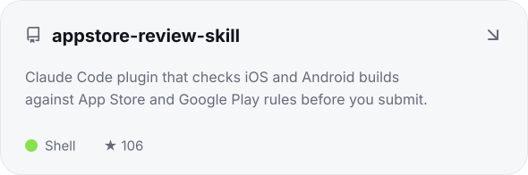
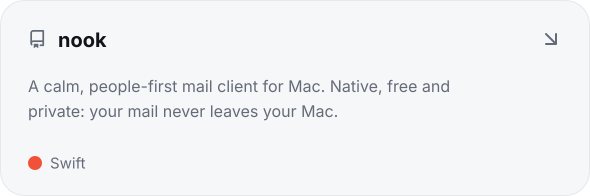
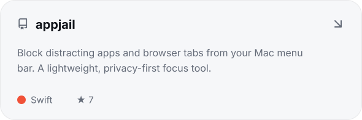
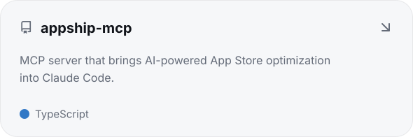
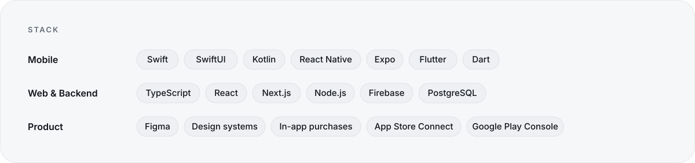
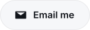
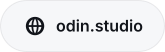

<picture><source media="(prefers-color-scheme: dark)" srcset="assets/header-dark.svg"></picture>

<picture><source media="(prefers-color-scheme: dark)" srcset="assets/section-open-source-dark.svg"></picture>

  <a href="https://github.com/devsemih/appstore-review-skill"><picture><source media="(prefers-color-scheme: dark)" srcset="assets/repo-appstore-review-skill-dark.svg"></picture></a>
  <a href="https://github.com/devsemih/nook"><picture><source media="(prefers-color-scheme: dark)" srcset="assets/repo-nook-dark.svg"></picture></a>

  <a href="https://github.com/devsemih/appjail"><picture><source media="(prefers-color-scheme: dark)" srcset="assets/repo-appjail-dark.svg"></picture></a>
  <a href="https://github.com/devsemih/appship-mcp"><picture><source media="(prefers-color-scheme: dark)" srcset="assets/repo-appship-mcp-dark.svg"></picture></a>

<picture><source media="(prefers-color-scheme: dark)" srcset="assets/stack-dark.svg"></picture>

  <a href="https://linkedin.com/in/semihh"><picture><source media="(prefers-color-scheme: dark)" srcset="assets/btn-linkedin-dark.svg"></picture></a>
  <a href="mailto:semihaslan305@gmail.com"><picture><source media="(prefers-color-scheme: dark)" srcset="assets/btn-email-dark.svg"></picture></a>
  <a href="https://odin.studio"><picture><source media="(prefers-color-scheme: dark)" srcset="assets/btn-web-dark.svg"></picture></a>

